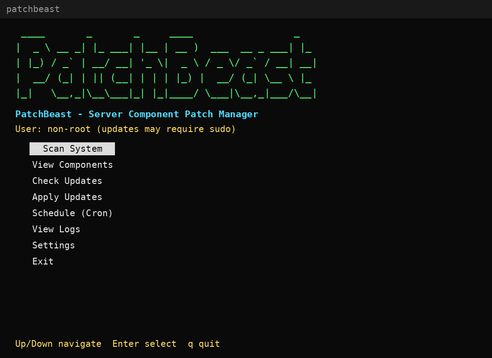
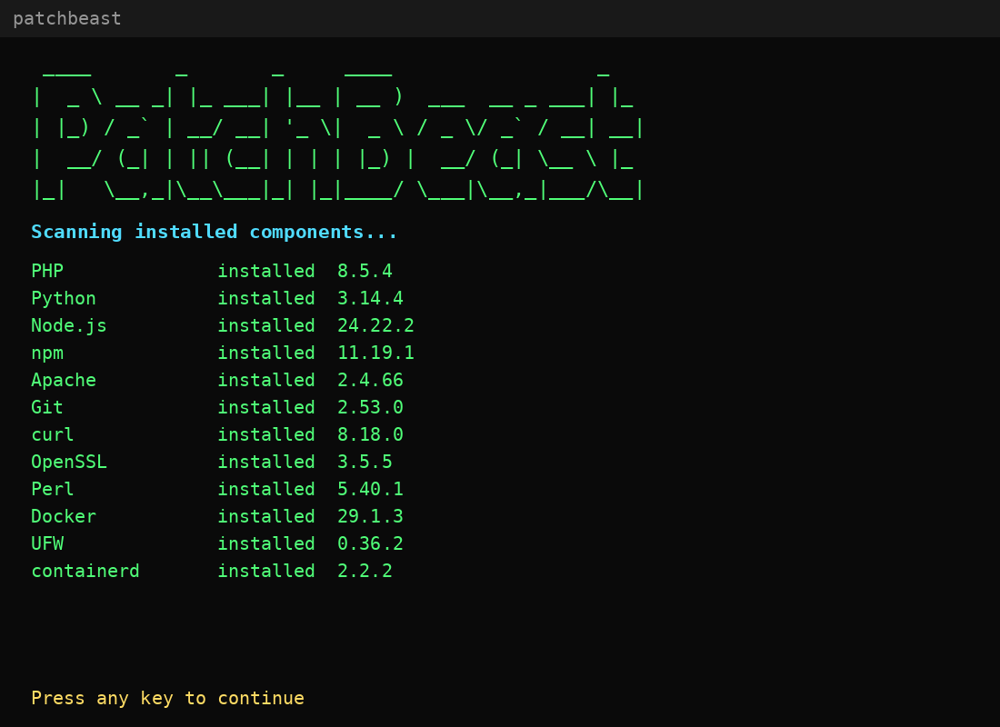
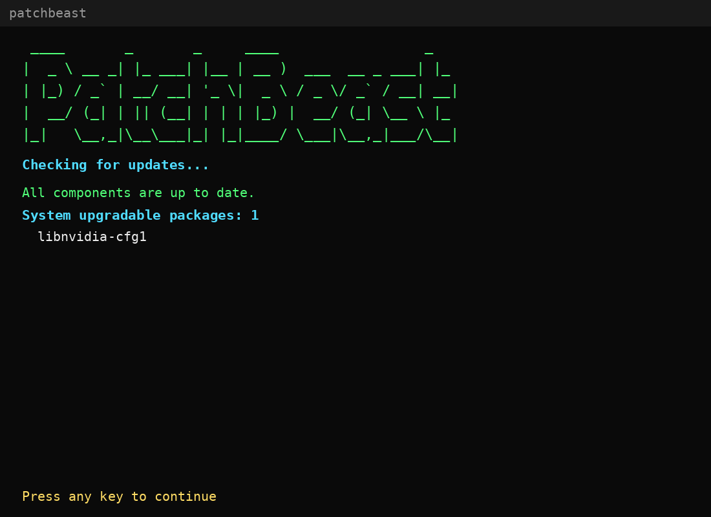
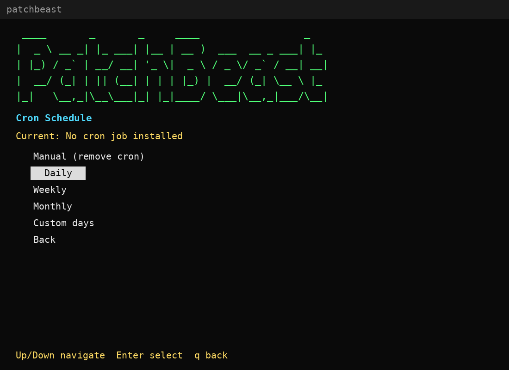

# PatchBeast

[](https://github.com/jonuisw09/patchbeast/actions/workflows/ci.yml)
[](https://www.python.org/)
[](LICENSE)

Terminal patch manager for Linux servers. PatchBeast detects installed
software components, compares versions against `apt`, applies patched
versions safely, restarts affected services, and schedules recurring scans
with cron.

No external dependencies — standard library + `curses` only.

## Contents

- [Screenshots](#screenshots)
- [Features](#features)
- [Requirements](#requirements)
- [Installation](#installation)
- [Usage](#usage)
- [Configuration](#configuration)
- [Project structure](#project-structure)
- [Development](#development)
- [Limitations](#limitations)
- [Security](#security)
- [License](#license)

## Screenshots

### Main menu



### Scan system



### Check updates



### Cron schedule



## Features

- Detects ~90 server components: runtimes, web servers, databases, mail,
  security, monitoring, containers, IaC tools, control panels
- Compares installed versions against `apt` candidates
- Lists system-wide upgradable packages via simulated `apt-get upgrade`
- Applies updates with `apt-get install -y --only-upgrade`
- Restarts affected services after successful updates
- Dry-run mode to plan without changing anything
- JSON scan reports for automation
- Cron scheduling: daily, weekly, monthly, custom interval
- Headless `--scan` mode for cron and automation
- Typed, tested codebase (`pytest`), linted (`ruff`), CI on every push

## Requirements

- Linux with `apt` (Debian / Ubuntu and derivatives)
- Python 3.9+
- `sudo` or root for update and cron operations
- Terminal with `curses` support

## Installation

From source:

```bash
git clone https://github.com/jonuisw09/patchbeast.git
cd patchbeast
./install.sh
patchbeast
```

With pip (editable, with dev tools):

```bash
pip install -e ".[dev]"
patchbeast
```

Run without installing:

```bash
PYTHONPATH=src python3 -m patchbeast
```

## Usage

Interactive TUI:

```bash
patchbeast
```

| Keys | Action |
|---|---|
| `Up` / `Down` or `k` / `j` | Move selection |
| `Enter` | Open the selected screen |
| `q` | Back / quit |

Menu:

- `Scan System` — installed / missing components
- `View Components` — versions, `apt` package, candidate
- `Check Updates` — component updates + system upgradable count
- `Apply Updates` — update components, optionally upgrade system
- `Schedule (Cron)` — daily / weekly / monthly / custom / remove
- `View Logs` — last 30 log lines
- `Settings` — toggle auto-update and dry-run
- `Exit`

Headless mode:

```bash
patchbeast --scan
patchbeast --scan --dry-run
patchbeast --scan --dry-run --report /tmp/report.json
patchbeast --scan --report ~/.config/patchbeast/last_report.json
```

Full usage guide: [`docs/USAGE.md`](docs/USAGE.md).
Architecture overview: [`docs/ARCHITECTURE.md`](docs/ARCHITECTURE.md).

## Configuration

Location:

```text
~/.config/patchbeast/config.json
~/.config/patchbeast/patchbeast.log
~/.config/patchbeast/last_report.json
~/.config/patchbeast/cache/
```

Example `config.json`:

```json
{
  "schedule": "manual",
  "schedule_days": 30,
  "auto_update": false,
  "dry_run": false,
  "components": []
}
```

| Key | Meaning |
|---|---|
| `auto_update` | Apply updates automatically in `--scan` mode |
| `dry_run` | Plan only, never change the system |
| `schedule`, `schedule_days` | Informational; the real schedule lives in cron |

Cron:

| Choice | Expression |
|---|---|
| Daily | `0 2 * * *` |
| Weekly | `0 2 * * 0` |
| Monthly | `0 2 1 * *` |
| Custom N days | `0 2 */N * *` |
| Manual | Removes the job |

Root installs `/etc/cron.d/patchbeast`; otherwise a user `crontab` entry
tagged `# patchbeast-managed`. Cron runs `patchbeast --scan`.

Service restart map:

| Package | Service |
|---|---|
| `php` | `php-fpm` |
| `apache2` | `apache2` |
| `nginx` | `nginx` |
| `mariadb-server` | `mariadb` |
| `postgresql` | `postgresql` |
| `redis-server` | `redis-server` |

Reports (`--report`) write JSON:

```json
{
  "components": [],
  "component_updates": [],
  "system_updates": [],
  "dry_run": true
}
```

Default path when omitted: `~/.config/patchbeast/last_report.json`.

## Project structure

```text
src/patchbeast/
  __init__.py      # __version__ + public API
  __main__.py      # thin python -m entry point
  cli.py           # argparse + headless_scan()
  components.py    # static component registry (~90 entries)
  scanner.py       # detect(), apt_candidate(), apt_installed_version()
  updater.py       # check/update/upgrade + SERVICE_MAP
  scheduler.py     # cron install/remove/status
  config.py        # JSON config under ~/.config/patchbeast/
  utils.py         # run(), parse_version(), log(), ...
  logo.py          # ASCII logo
  tui/
    app.py         # main menu loop + run_tui()
    screens.py     # one screen per menu entry
    widgets.py     # safe_addstr(), draw_logo(), pause()
tests/             # pytest suite (all core modules)
docs/
  ARCHITECTURE.md
  USAGE.md
  screenshots/
.github/workflows/ci.yml
Makefile
CHANGELOG.md
CONTRIBUTING.md
install.sh
pyproject.toml
```

## Development

```bash
make install   # pip install -e ".[dev]"
make test      # compileall + pytest
make lint      # ruff
make run       # interactive TUI
make scan      # headless dry-run
```

Contributions: see [`CONTRIBUTING.md`](CONTRIBUTING.md).
Changelog: see [`CHANGELOG.md`](CHANGELOG.md).

## Limitations

- Update backend is `apt` only.
- Components installed via `pip`, `npm -g`, `composer global`, binary
  installers, Docker images, or panel-specific updaters are detected but
  not auto-updated.
- `apt-get update`, upgrades, service restarts, and system cron require
  root or passwordless `sudo`.
- Package names follow Debian / Ubuntu conventions and may differ on
  other distros.

## Security

Do not run untrusted cron commands as root. Review
`~/.config/patchbeast/patchbeast.log` after automated runs. Use dry-run
first on production systems.

## License

MIT. See [`LICENSE`](LICENSE).
